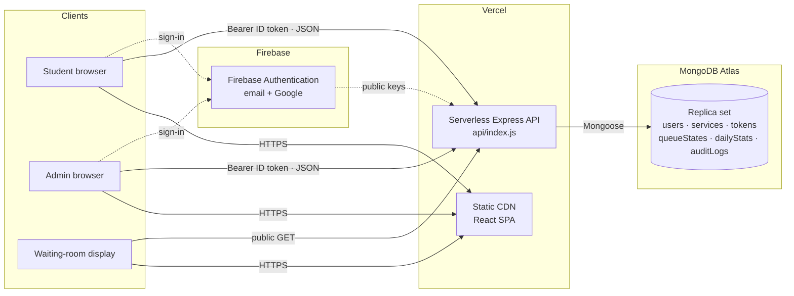

# CloudQueue

**Cloud-based queue management for campus administrative offices.**

CloudQueue replaces physical corridor lines with a digital token system. A student picks an office, receives a numbered token, and watches their live position and estimated wait from any device. Office staff call the next token from an admin console, while a public waiting-room screen shows the number currently being served. Every client reads the same source of truth in the cloud, so the number on a phone matches the number on the wall.

Built as a cloud-computing course project (CCSA), the application is deliberately **production-shaped**: a static React SPA on a CDN, a stateless serverless Express API, MongoDB Atlas for durable state, Firebase Authentication for identity, role-based access control, rate limiting, input validation and an append-only audit trail.

---

## Table of contents

- [Live deployment](#live-deployment)
- [Features](#features)
- [Technology stack](#technology-stack)
- [Architecture](#architecture)
- [Repository layout](#repository-layout)
- [Quick start (local)](#quick-start-local)
- [Demo accounts](#demo-accounts)
- [Demo mode vs production mode](#demo-mode-vs-production-mode)
- [Environment variables](#environment-variables)
- [Deploying to Vercel + MongoDB Atlas + Firebase](#deploying-to-vercel--mongodb-atlas--firebase)
- [API reference](#api-reference)
- [Data model](#data-model)
- [Security controls](#security-controls)
- [Testing](#testing)
- [Screenshots](#screenshots)
- [Scripts](#scripts)
- [Limitations and roadmap](#limitations-and-roadmap)
- [Project documents](#project-documents)

---

## Live deployment

> **Status: deployment-ready, public URL pending.**
>
> **Source repository:** <https://github.com/Anamika-garg/CloudQueue>
>
> The repository contains a complete Vercel configuration (`vercel.json`), environment templates and a MongoDB seed script. A public URL requires the owner's Vercel, MongoDB Atlas and Firebase projects, which are not available to the build environment. Once deployed, record the URL here:
>
> ```
> https://<your-project>.vercel.app
> ```

The application runs end-to-end **without any external account** thanks to demo mode (see [Demo mode vs production mode](#demo-mode-vs-production-mode)). That is the fastest way to review the project.

---

## Features

### Student experience

- **Digital tokens** for Registrar, Campus Clinic, Library Services and Bursary (services are configurable).
- **Live position, people ahead and ETA**, refreshed by polling every 8 seconds.
- **One active token per office per day**, enforced by a unique rule and a friendly `409` response.
- **Cancel a waiting token** at any time; the place is released immediately.
- **Personal history** of issued, served, cancelled and no-show tokens.
- **"It's your turn" toast** when the counter calls your number.
- Responsive layout for phone, tablet and desktop; accessible labels and focus states.

### Office administrator

- **Queue control**: current serving token, waiting list, average service time and projected wait.
- **Call next token** — atomically closes the previous token and claims the oldest waiting token.
- **Mark served / no-show** for edge cases such as a student who leaves.
- **Daily KPIs**: issued, served, average wait, no-shows, cancellations and peak hour.
- **Chart.js analytics**: tokens issued vs served per hour, and average wait by hour.
- **Daily history** with pagination and **CSV export**.
- **Audit log** of privileged actions.

### Super administrator

- **Create, edit, deactivate and delete services** (services with history are deactivated, not destroyed).
- **Configure service rate and accent colour** used by charts and the display board.
- **Manage staff roles** (`user`, `admin`, `super_admin`) with a guard against removing your own super-admin role.

### Public display board

- Full-screen, dark waiting-room view for a lobby TV or kiosk.
- Shows the token being served, waiting count and estimated wait per office.
- Polls every 5 seconds; shows no names, emails or other personal data.

---

## Technology stack

| Layer | Technology | Why |
|---|---|---|
| UI | **React 18 + Vite 5** | Fast builds, static output, component model |
| Styling | **Tailwind CSS 3** | Utility-first design system, tiny production CSS |
| Charts | **Chart.js 4 + react-chartjs-2** | Mature canvas charts with small integration surface |
| API | **Node.js 20 + Express 4** | Familiar routing/middleware; exported as a serverless handler |
| Hosting | **Vercel** | Static CDN + serverless functions in one project |
| Database | **MongoDB Atlas + Mongoose 8** | Managed replica set, flexible documents, atomic operators |
| Auth | **Firebase Authentication** | Email/password and Google sign-in; ID tokens verified server-side |
| Validation | **Zod** | Schema validation with coercions and clear error details |
| Security | **helmet, cors, express-rate-limit** | Headers, origin allow-list, abuse protection |

No WebSockets, no always-on server, no ORM other than Mongoose.

---

## Architecture



### Request lifecycle

1. The SPA is served from Vercel's CDN. `vercel.json` rewrites unknown non-API paths to `/index.html` so React Router deep links work.
2. The browser obtains a Firebase ID token (or, in demo mode, an HMAC-signed session token from the API).
3. `apiFetch` attaches `Authorization: Bearer <token>` to every call.
4. The Express app verifies the token, loads the **user record and role from the database**, and attaches `req.user`. Role claims on the wire are never trusted.
5. Domain logic executes in `api/src/services/queueService.js` against a repository interface implemented by either the MongoDB or in-memory adapter.
6. JSON responses are returned with `Cache-Control: no-store` for live queue data.

### Why serverless fits

Queue traffic is bursty: quiet between classes, then many students arrive at once. Serverless functions scale per request and cost nothing while idle, and Vercel's CDN absorbs the SPA. The trade-off — cold starts and a 10-second execution ceiling — is acceptable because every API request is short and clients poll instead of holding a socket.

---

## Repository layout

```
CCSA_Project/
├── api/                         # Serverless Express API
│   ├── index.js                 # Vercel handler (no app.listen)
│   ├── dev-server.js            # Local server; also serves client/dist
│   ├── scripts/seed.js          # MongoDB Atlas seed entry point
│   └── src/
│       ├── app.js               # Express factory, middleware, routing
│       ├── config/env.js        # Environment parsing and mode detection
│       ├── db/
│       │   ├── index.js         # One cached store per process
│       │   ├── mongo.js         # MongoDB adapter (atomic operators)
│       │   ├── memory.js        # In-memory adapter (demo/test)
│       │   └── seed.js          # Deterministic demo dataset
│       ├── lib/                 # dateKey, metrics, HTTP errors
│       ├── middleware/          # auth, validation, rate limits, errors
│       ├── models/              # Mongoose schemas and indexes
│       ├── routes/              # auth, services, tokens, queue, admin, health
│       ├── services/            # queue domain logic + audit
│       └── validation/          # Zod schemas
├── client/                      # React SPA
│   ├── src/
│   │   ├── components/          # shell, cards, charts, modal, toast
│   │   ├── hooks/usePolling.js  # visibility-aware polling
│   │   ├── lib/                 # api client, auth context, Firebase, format
│   │   └── pages/               # Landing, Dashboard, Admin, ServiceAdmin, Display
│   ├── tailwind.config.js
│   └── vite.config.js
├── scripts/smoke-test.mjs       # 53-assertion end-to-end suite
├── .env.example                 # Server environment template
├── client/.env.example          # Frontend environment template
├── package.json                 # Root scripts (dev, build, seed, test)
├── vercel.json                  # Builds and routes for Vercel
├── REPORT.md                    # Formal project report
└── DEMO_SCRIPT.md               # Timed demo walkthrough
```

---

## Quick start (local)

**Prerequisites:** Node.js 20+ and npm. No database or Firebase account is required for the demo.

```bash
# 1. Install API dependencies
npm install

# 2. Build the SPA into client/dist
npm run build

# 3. Start the app (API + built SPA on one port)
npm run dev
```

Open **http://localhost:4000**.

The server prints its auth and database mode:

```
CloudQueue API
-> http://localhost:4000/api/health
-> http://localhost:4000/api
auth mode : demo (HMAC tokens)
database  : in-memory (resets on restart)
frontend  : serving client/dist
```

### Hot-reload development

Run the API and Vite in two terminals:

```bash
# terminal 1 - API on :4000
npm run dev

# terminal 2 - Vite on :5173 with /api proxied to :4000
npm run client:dev
```

Then use **http://localhost:5173**. Vite proxies `/api` to `http://localhost:4000` (see `client/vite.config.js`).

> Demo mode is auto-enabled when Firebase credentials are absent, and the in-memory store is used when `MONGODB_URI` is empty. The first boot writes a deterministic three-day dataset (and refreshes it once per campus day), so demos and screenshots look the same every time.

---

## Demo accounts

The sign-in screen shows two password-protected demo accounts. Use these for review, grading or a public deployment:

| Role | Email | Password | Name | Lands on |
|---|---|---|---|---|
| `user` | `student@edu.ac.in` | `Student@123` | Aarav Sharma | `/app` (student dashboard) |
| `super_admin` | `superadmin@admin.com` | `SuperAdmin@123` | Daniel Osei | `/admin` + Services link |

Both accounts are seeded with the full demo dataset, so the student opens with **30 personal tokens of history** across the three demo days and the super admin sees populated queues, charts and audit log. The student deliberately has **no live token**, so the "get a token" walkthrough always starts clean.

In pure demo mode (`DEMO_MODE=true`) any email still signs in without a password, and one persona per role (including `admin@campus.edu`) is offered as a one-click button. When Firebase is configured but `ALLOW_DEMO_LOGIN=true`, only the two credential accounts above are accepted by `/api/auth/demo-login`.

Additional seeded students (`fatima@`, `marcus@`, `lena@`, `yusuf@campus.edu`) populate the queue and history.

`GET /api/auth/demo-accounts` returns the seven canonical personas (merged with any stored display name or role) plus a `credentials` array with the two password accounts, so the sign-in screen never picks up unrelated accounts from a shared database. Both lists come from `api/src/config/demoAccounts.js` and `api/src/db/seed.js`; keep them in sync with this table.

---

## Demo mode vs production mode

| | Demo mode | Production mode |
|---|---|---|
| Activation | `DEMO_MODE=true`, or automatically when Firebase credentials are missing | `DEMO_MODE=false` with complete Firebase credentials |
| Identity | HMAC-signed JWT issued by `POST /api/auth/demo-login` | Firebase ID token verified with the Admin SDK (plus optional demo personas when `ALLOW_DEMO_LOGIN=true`) |
| Token lifetime | 12 hours, stored in `sessionStorage` | Firebase-managed, short-lived and auto-refreshed |
| Password | Ignored for arbitrary emails; required for the two advertised demo credentials | Enforced by Firebase; demo credentials still require `Student@123` / `SuperAdmin@123` when `ALLOW_DEMO_LOGIN=true` |
| Database | In-memory (unless `MONGODB_URI` is set) | MongoDB Atlas |
| Demo dataset | Refreshed automatically | Refreshed automatically when `SEED_DEMO_DATA=true`; otherwise only bootstrapped into an empty database |
| `/api/auth/demo-login` | Available | Returns `404` unless `ALLOW_DEMO_LOGIN=true`, which enables the two password accounts |
| Intended use | Local review, grading, demos | Real deployment |

The client asks `GET /api/health` which mode the server is in and adapts its login UI accordingly. The server is the single source of truth.

---

## Environment variables

Copy `.env.example` to `.env` at the repository root. On Vercel, add the same keys under **Project → Settings → Environment Variables**.

### Server (`api/`)

| Variable | Required | Default | Description |
|---|---|---|---|
| `NODE_ENV` | No | `development` | `production` enables production hardening |
| `PORT` | No | `4000` | Local dev server port (ignored by Vercel) |
| `CAMPUS_TIMEZONE` | Recommended | machine time zone | IANA zone used for the daily `dateKey`. **Set explicitly on Vercel** (it runs in UTC), e.g. `Asia/Kolkata` |
| `FRONTEND_ORIGIN` | Yes in production | `http://localhost:5173,http://localhost:4000` | Comma-separated CORS allow-list. Include the deployed Vercel origin |
| `MONGODB_URI` | Production | empty → in-memory | Atlas connection string including the database name |
| `FIREBASE_PROJECT_ID` | Production | empty | Service-account project ID |
| `FIREBASE_CLIENT_EMAIL` | Production | empty | Service-account client email |
| `FIREBASE_PRIVATE_KEY` | Production | empty | Service-account private key; keep `\n` escapes |
| `SUPER_ADMIN_EMAILS` | No | empty | Comma-separated emails promoted to `super_admin` on first sign-in |
| `DEMO_MODE` | No | auto | `true` forces demo auth; `false` forces Firebase |
| `ALLOW_DEMO_LOGIN` | No | `false` | Keeps the one-click demo personas enabled even when Firebase is configured (hybrid mode). Useful for a public graded deployment |
| `SEED_DEMO_DATA` | No | follows `DEMO_MODE` | `true` writes/refreshes the deterministic demo dataset once per campus day. Set to `true` on a graded deployment so the dashboards are never empty |
| `DEMO_JWT_SECRET` | Demo only | insecure default | HMAC secret for demo sessions. **Always override before exposing a demo publicly** |
| `DISABLE_RATE_LIMIT` | No | `false` | Bypasses rate limits (local load tests only) |

### Client (`client/`)

Vite exposes only `VITE_*` variables to the browser. Copy `client/.env.example` to `client/.env.local` for local development.

| Variable | Required | Description |
|---|---|---|
| `VITE_API_URL` | No | API base URL. Leave empty when the SPA and API share an origin |
| `VITE_FIREBASE_API_KEY` | Firebase mode | Firebase web API key |
| `VITE_FIREBASE_AUTH_DOMAIN` | Firebase mode | e.g. `your-project.firebaseapp.com` |
| `VITE_FIREBASE_PROJECT_ID` | Firebase mode | Firebase project ID |
| `VITE_FIREBASE_APP_ID` | Firebase mode | Firebase web app ID |
| `VITE_FIREBASE_MESSAGING_SENDER_ID` | Firebase mode | Sender ID |

### Secrets and `.env`

- `.env` is ignored by `.gitignore`; only `.env.example` is committed.
- Never commit service-account JSON or the demo JWT secret.
- Rotate the Firebase service-account key and `DEMO_JWT_SECRET` if either is exposed.

---

## Deploying to Vercel + MongoDB Atlas + Firebase

The repository is deployment-ready. Three managed services are required.

### 1. MongoDB Atlas

1. Create a free **M0** cluster and a database user with `readWrite` on the `cloudqueue` database.
2. **Network Access**:
   - Simplest demo: allow `0.0.0.0/0`.
   - Stronger: allow only Vercel egress ranges, or use **Atlas Private Endpoint / VPC peering** on a paid tier. Serverless egress IPs are not guaranteed on the free plan, which is why the template documents the open-IP trade-off explicitly.
3. Copy the SRV connection string, append `/cloudqueue?retryWrites=true&w=majority`, and store it as `MONGODB_URI`.
4. Demo data is written automatically on first request (see below). You can also run it manually:

   ```bash
   # PowerShell
   $env:MONGODB_URI="mongodb+srv://..."
   $env:CAMPUS_TIMEZONE="Asia/Kolkata"
   npm run seed
   ```

   The seeder is idempotent: it clears the demo offices' tokens for the three-day window before inserting, so restarts never duplicate tickets or shift token numbers.

### Automatic demo dataset

The API seeds the fictional campus dataset on startup, before the first request is served:

- **`DEMO_MODE=true` or `SEED_DEMO_DATA=true`** → the data is refreshed **once per campus day**, including in production.
- **Otherwise** → a completely empty database is bootstrapped once, so a fresh deployment never renders blank dashboards.

A `seedstates` collection stores one marker per campus day (`unique` index). Concurrent serverless instances race to claim that marker, so only one seeder runs and the data is never written twice. The deployed site therefore shows the same services, queue and charts as the local demo.

### 2. Firebase Authentication

1. Create a Firebase project and add a **Web** app.
2. Enable **Email/Password** and (optionally) **Google** under Authentication → Sign-in method.
3. Under **Project settings → Service accounts**, generate a new private key. Add `FIREBASE_PROJECT_ID`, `FIREBASE_CLIENT_EMAIL` and `FIREBASE_PRIVATE_KEY` to the server environment. Preserve the `\n` escapes in the private key.
4. Add the Vercel domain (e.g. `your-project.vercel.app`) under **Authentication → Settings → Authorized domains**.
5. Add the `VITE_FIREBASE_*` values to the client environment and rebuild.
6. Set `SUPER_ADMIN_EMAILS` to the bootstrap administrator's email so the first sign-in receives `super_admin`.

### 3. Vercel

1. Import the repository into Vercel.
2. Framework preset: **Other**. `vercel.json` declares the modern build settings:
   - `buildCommand: "npm run build"` and `outputDirectory: "client/dist"`
   - `api/index.js` → a Node serverless function with `maxDuration: 30`
   - `/api/*` → the function, and every other path → `/index.html` (SPA fallback)
   The fallback is what makes a deep link such as `/admin` return `200` instead of `404` on refresh or direct navigation.
3. Add all server and client environment variables for **Production** (and Preview if desired).
4. Set `FRONTEND_ORIGIN` to the final deployment origin, for example `https://your-project.vercel.app`. Same-origin browser requests still send an `Origin` header on some methods, so the deployed origin must be listed.
5. Set `SEED_DEMO_DATA=true` (and an explicit `CAMPUS_TIMEZONE`) so the demo dataset appears on the deployed site. Leave `DEMO_MODE=false` when Firebase is configured, and add `ALLOW_DEMO_LOGIN=true` if you also want the one-click demo personas on the sign-in screen.
6. Deploy. Verify:
   - `https://<app>/api/health` → `status: "ok"`, `database: "mongodb-atlas"`, `authMode: "firebase"`
   - `https://<app>/admin` refreshed directly → `200` (no 404)
   - Sign in with a Firebase account, then promote roles from the Services & access page or via `SUPER_ADMIN_EMAILS`.
7. Re-deploy after changing any build-time `VITE_*` variable — Vite inlines them at build time.

### Deployment checklist

- [ ] Atlas cluster, database user and network access configured
- [ ] `MONGODB_URI` set on Vercel
- [ ] Firebase email/Google providers enabled
- [ ] Service-account credentials set on Vercel
- [ ] `VITE_FIREBASE_*` set and client rebuilt
- [ ] Vercel domain added to Firebase authorized domains
- [ ] `FRONTEND_ORIGIN` matches the deployed origin
- [ ] `CAMPUS_TIMEZONE` set explicitly
- [ ] `SEED_DEMO_DATA=true` so the demo dataset is visible in production
- [ ] `ALLOW_DEMO_LOGIN=true` if the seeded personas should be clickable on the deployed site
- [ ] `DEMO_MODE=false`
- [ ] `DEMO_JWT_SECRET` rotated or demo sign-in disabled
- [ ] `SUPER_ADMIN_EMAILS` set for the first administrator
- [ ] `GET /api/health` returns `ok`

---

## API reference

Base URL: `/api`. Authenticated routes expect `Authorization: Bearer <Firebase ID token or demo token>`.

| Method | Endpoint | Access | Description |
|---|---|---|---|
| `GET` | `/api` | Public | API index and endpoint list |
| `GET` | `/api/health` | Public | Liveness/readiness probe with database latency |
| `POST` | `/api/auth/sync` | Authenticated | Return the authoritative profile and role; provisions the user |
| `GET` | `/api/auth/me` | Authenticated | Current user profile |
| `POST` | `/api/auth/demo-login` | Public (demo only) | Mint a demo session token for an email |
| `GET` | `/api/auth/demo-accounts` | Public (demo only) | Suggested demo personas |
| `GET` | `/api/services` | Public | Active services |
| `GET` | `/api/services/:id` | Public | One service |
| `POST` | `/api/services` | `super_admin` | Create a service |
| `PATCH` | `/api/services/:id` | `super_admin` | Update a service |
| `DELETE` | `/api/services/:id` | `super_admin` | Delete, or deactivate if it has history |
| `POST` | `/api/tokens` | `user`+ | Issue a token for `{ serviceId }` |
| `GET` | `/api/tokens/my?date=` | `user`+ | Active tokens and recent history |
| `DELETE` | `/api/tokens/:id` | Owner or `admin`+ | Cancel a waiting token |
| `GET` | `/api/queue/status?serviceId=` | Public | Live queue snapshot (no personal data) |
| `GET` | `/api/queue/position?serviceId=` | Authenticated | Your position, people ahead and ETA |
| `GET` | `/api/queue/board` | Public | Display-board rows for all services |
| `POST` | `/api/admin/call-next` | `admin`+ | Close the current token and claim the next |
| `POST` | `/api/admin/mark-served/:tokenId` | `admin`+ | `{ action: "served" \| "no_show" }` |
| `GET` | `/api/admin/queue?serviceId=&date=` | `admin`+ | Full queue for the control panel |
| `GET` | `/api/admin/stats?serviceId=&date=` | `admin`+ | Daily KPIs and 24-hour breakdown |
| `GET` | `/api/admin/history?serviceId=&date=&page=&limit=` | `admin`+ | Paginated token history |
| `GET` | `/api/admin/audit?limit=&action=` | `admin`+ | Recent privileged actions |
| `GET` | `/api/admin/services` | `admin`+ | Services including inactive ones |
| `GET` | `/api/admin/users` | `super_admin` | All user accounts |
| `PATCH` | `/api/admin/users/:id/role` | `super_admin` | Change a role |

### Response conventions

Success responses are JSON objects (`{ token }`, `{ services }`, `{ stats }`, …). Errors are shaped consistently:

```json
{
  "error": {
    "code": "active_token_exists",
    "message": "You already hold token REG-014 for Registrar. Cancel it before taking a new one.",
    "details": []
  }
}
```

| Status | Meaning |
|---|---|
| `400` | Validation error (`details` lists field-level issues) |
| `401` | Missing, invalid or expired token |
| `403` | Authenticated but the role is insufficient |
| `404` | Unknown route, service or token |
| `409` | Business-rule conflict (active token, duplicate code, closed token) |
| `429` | Rate limit exceeded |
| `503` | Database unreachable (`/api/health`) |

### Example: issue a token

```bash
curl -X POST http://localhost:4000/api/tokens \
  -H "Authorization: Bearer <token>" \
  -H "Content-Type: application/json" \
  -d '{"serviceId":"<24-char id>"}'
```

```json
{
  "token": {
    "id": "…",
    "tokenNumber": "REG-014",
    "status": "waiting",
    "position": 3,
    "estimatedWaitMinutes": 18,
    "ahead": ["REG-012", "REG-013"],
    "currentServingToken": "REG-011",
    "waitingCount": 4
  },
  "service": { "code": "REG", "name": "Registrar", "…": "…" },
  "queue": { "serving": { "tokenNumber": "REG-011" }, "waitingCount": 4, "…": "…" }
}
```

---

## Data model

Six collections, all with timestamps and schema-level validation.

| Collection | Purpose | Important fields and indexes |
|---|---|---|
| `users` | Provisioned on first authenticated request | `firebaseUid` (unique), `email` (index), `role` (index), `displayName`, `lastLoginAt` |
| `services` | Campus offices | `code` (unique), `name`, `location`, `averageServiceMinutes`, `color`, `isActive` (index) |
| `tokens` | One row per issued ticket | `tokenNumber`, `serviceId`, `userId`, `status`, `issuedSequence`, `dateKey`, `waitMinutes`, `serviceMinutes` |
| `queuestates` | One row per service per day | `lastIssuedSequence` (atomic `$inc`), `currentServingTokenId`, unique `{serviceId, dateKey}` |
| `dailystats` | Materialised daily roll-up / report cache | Totals, averages, peak hour, 24-hour breakdown, unique `{serviceId, dateKey}` |
| `auditlogs` | Append-only privileged action trail | `action` (index), `performedBy`, `target`, `serviceId`, `metadata`, `createdAt` (index) |

Key token indexes:

```js
{ serviceId: 1, dateKey: 1, tokenNumber: 1 }   // unique ticket number
{ serviceId: 1, dateKey: 1, status: 1, issuedSequence: 1 } // call-next hot path
{ userId: 1, dateKey: -1 }                     // personal history
{ userId: 1, status: 1 }                       // active-token lookup
{ dateKey: -1, serviceId: 1, issuedAt: -1 }    // admin pagination
```

### Atomicity and concurrency

- **Token numbers** come from `findOneAndUpdate(..., { $inc: { lastIssuedSequence: 1 } }, { upsert: true, new: true })`, so concurrent requests never receive the same number. A unique index on `{serviceId, dateKey, tokenNumber}` is the final backstop.
- **Call-next** uses `findOneAndUpdate` with `{ status: 'waiting' }` sorted by `issuedSequence`, so two administrators clicking simultaneously claim different tokens. The smoke test exercises this with parallel requests.
- **One token per user per service per day** is checked before issuance. Under an extreme race, a partial unique index on active tokens is the recommended hardening step (see the report's limitations).
- The in-memory adapter uses Node's single-threaded event loop for the same guarantees within one process; the MongoDB adapter is the production path.

### Queue algorithm

1. **Issue**: verify the service is active, ensure the user has no active token for that service today, atomically increment the day's sequence, build `CODE-NNN`, persist the token and audit the action.
2. **Call next**: read queue state; if someone is serving, mark them served and compute service minutes. Atomically claim the oldest waiting token. Point `currentServingTokenId` at it.
3. **Serve / no-show**: close a specific token, clear it from queue state, audit the action.
4. **ETA**: `(people ahead + current serving) × effective service minutes`, where the effective rate blends the configured average with today's completed service durations.
5. **Daily reset**: the `dateKey` is computed in `CAMPUS_TIMEZONE`, so each campus day starts a new sequence without a destructive reset job.

---

## Security controls

- **Authentication** — Firebase ID tokens verified server-side with the Admin SDK (`verifyIdToken(token, true)` checks revocation). Demo tokens are HMAC-signed with issuer/audience and a 12-hour expiry.
- **Authorization** — Roles live in MongoDB and are loaded on every request; `requireRole` and `requireAtLeast` gate admin routes. Client-side route guards are convenience only; the API is authoritative.
- **Validation** — Zod schemas validate bodies and query strings, including `ObjectId` format, date keys, enums and size limits. Request bodies are capped at 64 KB.
- **Rate limiting** — Public reads 240/min, auth 30/min, writes 60/min per warm instance. For a hard global limit, swap in a Redis-backed store (noted as future work).
- **CORS** — Explicit origin allow-list; requests without an `Origin` header (curl, server-to-server) are allowed.
- **Headers** — `helmet` with `x-powered-by` disabled; TLS is terminated by Vercel.
- **Secrets** — Environment variables only; `.env` is ignored; `.env.example` contains placeholders.
- **Audit logging** — Append-only records for sign-ins, token issue/cancel, call-next, serve/no-show, service CRUD and role changes. Audit entries are visible to admins only.
- **Data minimisation** — Public endpoints expose token numbers and aggregates, never names, emails or user IDs. The display board is intentionally anonymous.
- **Least privilege** — Service CRUD and user-role management require `super_admin`; office admins can only operate queues.

### MongoDB network-access trade-off

Atlas must accept connections from Vercel's serverless egress, whose IPs are not stable on the free plan. The simplest configuration is `0.0.0.0/0`, protected by a strong database password and TLS. For a stricter posture, use Atlas private endpoints or allow-list stable egress (paid Vercel feature / NAT gateway), and enable Atlas audit logs and IP access-list alerts. This trade-off is documented in `REPORT.md`.

---

## Testing

### Automated end-to-end suite

```bash
# API must be running on :4000 in demo mode
npm test
```

`scripts/smoke-test.mjs` starts its own state against the running server and asserts **53 behaviours**, including:

- health, auth mode and database mode reporting
- public service and display-board reads
- anonymous and invalid-token rejection
- demo sign-in for all three roles
- student blocked from admin stats; admin blocked from service creation; student blocked from the user list
- validation failures (bad service payload, malformed service ID)
- service create/update and duplicate-code conflict
- token issuance, token-number format, position and ETA
- duplicate active-token conflict
- **8 concurrent token issues produce 8 unique numbers**
- **concurrent call-next never returns the same token twice**
- exactly one serving token per service
- serve/no-show transitions, double-close conflict, invalid action rejection
- owner cancellation, cross-user cancellation forbidden (`403`)
- stats totals and 24-hour breakdown, daily roll-up persistence, campus-wide roll-up
- history pagination
- audit entries for admin actions and token issues
- display board exposes serving/waiting data but **never personal data**
- JSON `404` for unknown API routes

Expected output ends with:

```
53 passed, 0 failed
```

### Manual verification

The full UI was exercised in a browser in demo mode:

1. Sign in as each persona; role-aware navigation appears correctly.
2. Issue a token; toast, position, ETA, ahead list and live queue update.
3. Call the token from the admin console; the student dashboard updates on the next poll and shows an "It's your turn" toast.
4. Mark served and no-show; history and KPIs change.
5. Confirm two Chart.js canvases render and the 24-hour breakdown matches the history.
6. Open `/display`; serving numbers and waiting counts poll every 5 seconds with no personal data.
7. Create a service and change a role as `super_admin`; changes appear immediately.
8. Confirm `/api/health` and `/api` respond, and unknown routes return JSON.

### Production build

```bash
npm run build
```

Vite emits `client/dist` with chunked React, Chart.js and Firebase bundles and roughly 47 KB of CSS.

---

## Screenshots

The project is designed to be demoed live. If you want static captures for a report or slides, run the app and capture:

| Suggested file | Page | What to capture |
|---|---|---|
| `docs/screenshots/01-landing.png` | `/` | Hero, feature cards and demo sign-in card |
| `docs/screenshots/02-student-dashboard.png` | `/app` | Active token, live queue and service cards |
| `docs/screenshots/03-admin-console.png` | `/admin` | Now-serving banner, KPIs and charts |
| `docs/screenshots/04-display-board.png` | `/display` | Full-screen dark board |
| `docs/screenshots/05-services.png` | `/admin/services` | Service CRUD cards and staff roles |

Use a 1440 × 900 viewport for desktop shots and 390 × 844 for mobile. Demo mode reseeds deterministically on restart, so captures are repeatable. Keep personal data fictional (the seed uses invented names).

---

## Scripts

| Command | What it does |
|---|---|
| `npm run dev` | Start the API (and built SPA, if present) at `http://localhost:4000` |
| `npm start` | Alias for `npm run dev` |
| `npm run build` | Install client dependencies and build the SPA to `client/dist` |
| `npm run client:dev` | Vite dev server on `:5173` with `/api` proxy |
| `npm run seed` | Seed MongoDB Atlas using `MONGODB_URI` |
| `npm test` | Run the 53-assertion smoke suite against a running API |

---

## Limitations and roadmap

### Known limitations

- **Public URL pending** — deployment requires owner credentials; the repository and configuration are complete.
- **Demo data is ephemeral** — the in-memory store resets on restart. Atlas mode persists.
- **Per-instance rate limiting** — counters are not shared across serverless instances. A Redis-backed limiter is the production fix.
- **Polling, not push** — clients refresh every 5–10 seconds, so a called token can take up to one interval to appear. This is a deliberate trade-off for serverless compatibility and cost.
- **Single-region by default** — Atlas M0 and Vercel functions are regional. Multi-region reads require a larger Atlas tier and a read-preference strategy.
- **No automated browser tests** — the smoke suite covers the API; UI flows were verified manually.
- **No email/SMS notifications** — the "your turn" signal is in-app only.
- **Service deletion is soft** — services with history are deactivated to preserve reporting, by design.
- **Atlas network access** — the free-tier demo typically uses `0.0.0.0/0`; production should use private networking.

### Future enhancements

1. **Push notifications** (Firebase Cloud Messaging) for "your turn" and "10 minutes away".
2. **Redis-backed rate limiting and caching** (Upstash) for global guarantees and fewer Atlas reads.
3. **Server-Sent Events or WebSockets** on a long-lived runtime for sub-second updates, while keeping polling as a fallback.
4. **Appointment scheduling** alongside walk-in tokens.
5. **Multi-counter support** — several tellers per service, each with its own current token.
6. **SMS fallback** for students without smartphones.
7. **Accessibility audit** to WCAG 2.2 AA with screen-reader testing.
8. **Observability** — structured logs, OpenTelemetry traces and Vercel/Atlas dashboards.
9. **Partial unique index** on `{userId, serviceId, dateKey}` for active tokens to make the one-token rule race-proof.
10. **Nightly aggregation job** to own `dailyStats` and support term-level reporting.
11. **End-to-end browser tests** with Playwright in CI.
12. **Localisation** for multilingual campuses.

---

## Project documents

- [`REPORT.md`](./REPORT.md) — formal report: problem, objectives, architecture, cloud services, security, scalability, limitations and cloud-concepts mapping.
- [`DEMO_SCRIPT.md`](./DEMO_SCRIPT.md) — timed walkthrough for a live demo or recorded video.

---

## Academic note

CloudQueue was built for a cloud-computing course project. Names, emails and queue data in the demo seed are fictional. The code is provided for learning and review. Third-party services (Vercel, MongoDB Atlas, Firebase) are subject to their own terms and free-tier limits.
