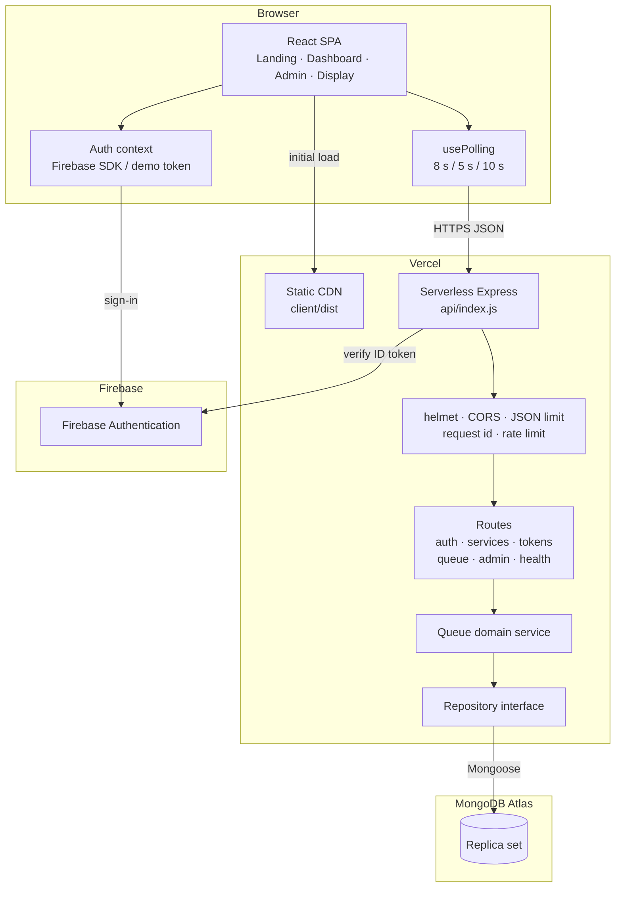
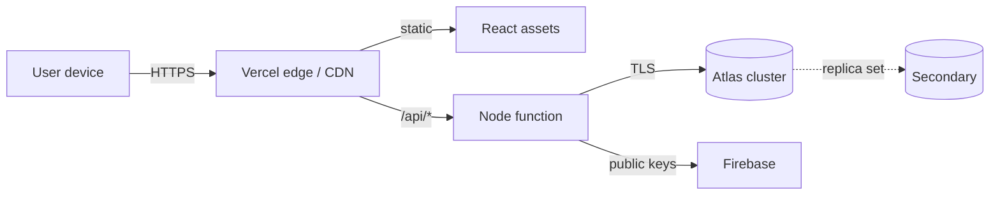
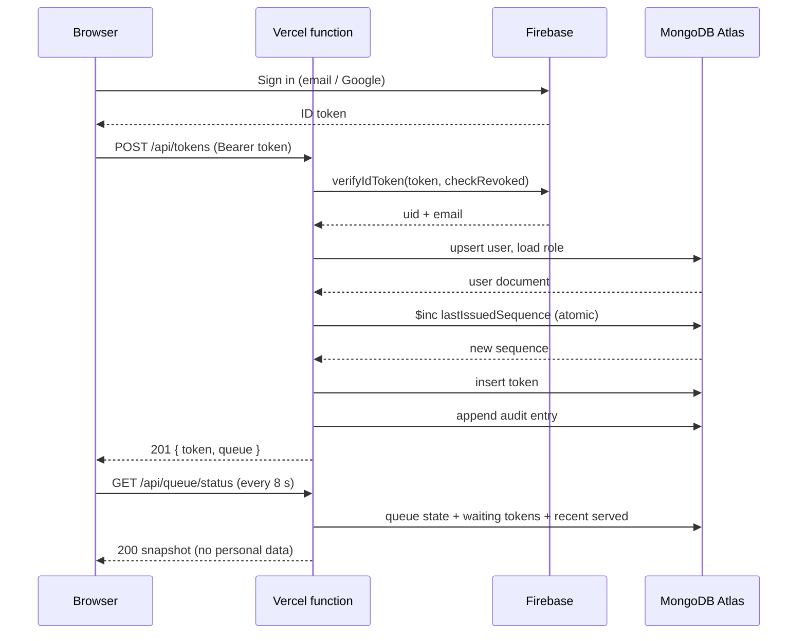

# CloudQueue: A Cloud-Based Queue Management System for Campus Administrative Services

**Project report — CCSA cloud computing project**

| | |
|---|---|
| **System** | CloudQueue v1.0.0 |
| **Stack** | React 18 · Vite 5 · Tailwind CSS 3 · Chart.js 4 · Node.js 20 · Express 4 · MongoDB Atlas · Firebase Authentication · Vercel |
| **Date** | November 2026 |
| **Companion documents** | [`README.md`](./README.md) · [`DEMO_SCRIPT.md`](./DEMO_SCRIPT.md) |

---

## Abstract

Campus administrative offices still rely on physical queues. Students arrive early, wait without information, and leave when patience runs out; staff cannot forecast demand; and a single slow counter degrades service for everyone. CloudQueue replaces the corridor line with a cloud-hosted digital token system. Students issue a token from any device and see their position and estimated wait time update automatically. Staff call the next token from a role-protected console, and a public display board shows the number being served in each office. The system is built on a static React single-page application distributed by a content delivery network, a stateless serverless Express API, MongoDB Atlas as the durable system of record, and Firebase Authentication for identity. It enforces role-based access control, validates every input, rate-limits abuse, and records privileged actions in an append-only audit log. Atomic database operators guarantee that concurrent requests never duplicate a token number or claim the same waiting token twice. A 53-assertion end-to-end suite verifies the API, including concurrency scenarios, and the complete product was exercised in a browser. The report explains the architecture, cloud-service rationale, data design, concurrency model, security posture, scalability and high-availability characteristics, the choice of polling over WebSockets, limitations and future work, and maps the implementation to core cloud-computing concepts.

---

## Table of contents

1. [Introduction](#1-introduction)
2. [Problem definition and requirements](#2-problem-definition-and-requirements)
3. [Objectives](#3-objectives)
4. [System architecture](#4-system-architecture)
5. [Cloud service selection](#5-cloud-service-selection)
6. [Data design](#6-data-design)
7. [Core queue algorithms](#7-core-queue-algorithms)
8. [Security design](#8-security-design)
9. [Scalability and high availability](#9-scalability-and-high-availability)
10. [Real-time strategy: polling versus WebSockets](#10-real-time-strategy-polling-versus-websockets)
11. [Testing and evaluation](#11-testing-and-evaluation)
12. [Limitations](#12-limitations)
13. [Future work](#13-future-work)
14. [Mapping to cloud-computing concepts](#14-mapping-to-cloud-computing-concepts)
15. [Conclusion](#15-conclusion)
16. [References](#16-references)

---

## 1. Introduction

### 1.1 Context

A university campus concentrates demand into short windows. Between lectures, hundreds of students may need the registrar, the clinic, the library or the bursary at the same time. The traditional control mechanism is a physical line: first-come, first-served, with no visibility into how long the wait will be. This creates three problems:

1. **Uncertainty.** A student cannot tell whether a visit will take ten minutes or an hour, so they either wait unnecessarily or abandon the queue.
2. **Congestion.** A crowd forms in a corridor, blocking access and making social distancing difficult.
3. **No operational data.** Staff cannot see arrival rates, peak hours, no-show rates or service duration, so staffing decisions are guesses.

A digital queue addresses all three. The queue becomes a shared cloud resource rather than a physical location. Students can wait anywhere, staff get a control surface, and every interaction produces data for planning.

### 1.2 Scope

CloudQueue covers walk-in queues for multiple campus offices on a single campus, one active queue per office per day, and three roles: student (`user`), office administrator (`admin`) and system administrator (`super_admin`). It does not cover appointments, payments, identity-card issuance, multi-campus tenancy or native mobile applications. Those are discussed as future work.

### 1.3 Why cloud computing

The workload is a natural fit for cloud delivery:

- **Bursty demand.** Load spikes at class breaks and lunch, then falls to near zero. Pay-per-request serverless compute matches this shape better than a provisioned server.
- **Shared state.** Phones, office desktops and a lobby display must see the same queue. A managed cloud database provides a single source of truth without the team operating a replica set.
- **Elastic reach.** The SPA is served from a CDN, so a student on mobile data and a display on campus Wi-Fi get the same low-latency experience.
- **Managed identity.** Authentication is security-sensitive and easy to get wrong. A managed identity provider supplies verified email/Google sign-in, token refresh and revocation.

---

## 2. Problem definition and requirements

### 2.1 Users and their needs

| Actor | Goal | Pain point today |
|---|---|---|
| Student | Get served with minimal wasted time | No wait visibility; must stay physically in line |
| Office administrator | Move the queue efficiently and fairly | Manual calling, disputes about order, no metrics |
| Super administrator | Configure offices and staff access | Hard-coded processes; no central control |
| Waiting-room visitor | Know which number is being served | Cannot read a small screen from a distance |

### 2.2 Functional requirements

**Students**

- Sign in with a campus identity.
- Browse active services with live waiting counts.
- Issue one token per service per day.
- View token number, position, people ahead, current serving number and estimated wait.
- Receive updates without manually refreshing.
- Cancel a waiting token.
- Review personal token history.

**Administrators**

- View the live queue for a service and date.
- Call the next token atomically.
- Mark a token served or no-show.
- View daily KPIs and hourly charts.
- Paginate and export daily history.
- Review an audit log.

**Super administrators**

- Create, update, deactivate and delete services.
- Configure service rate, location and colour.
- List users and change roles.
- Prevent self-demotion from `super_admin`.

**Public**

- View a display board with serving numbers and waiting counts, with no personal data.

### 2.3 Non-functional requirements

| Category | Requirement |
|---|---|
| Correctness | No duplicate token numbers; no token served by two counters; one active token per user per service per day |
| Security | Server-side token verification; RBAC enforced by the API; validated input; restricted CORS; rate limits; secrets only in environment variables; audit trail |
| Performance | Queue reads under a few hundred milliseconds at campus scale; poll interval 5–10 s |
| Availability | Static assets served from a CDN; managed database with replication; health probe |
| Scalability | Stateless API instances; horizontal scaling without sticky sessions |
| Maintainability | Clear separation of routes, domain logic and storage; interchangeable database adapters |
| Cost | Operate within free tiers for a course deployment |
| Usability | Responsive, accessible, informative empty and error states |

### 2.4 Constraints

- The mandated stack: React + Vite + Tailwind + Chart.js; Node/Express deployed as a Vercel serverless function (no `app.listen()` in production); MongoDB Atlas; Firebase Authentication; JavaScript polling rather than WebSockets.
- Vercel functions have a short execution ceiling (configured here as 10 seconds) and no durable in-process state.
- No credentials for third-party accounts were available in the build environment, so a zero-account demo path was required to make the project reviewable.

---

## 3. Objectives

1. **Digitise the queue** so a student can obtain and monitor a token from any browser.
2. **Create a single source of truth** shared by students, staff and the lobby display.
3. **Guarantee fairness under concurrency** through atomic sequence allocation and atomic claim of the next waiting token.
4. **Provide operational visibility** with daily KPIs, hourly charts, history and CSV export.
5. **Enforce security by design** with verified identity, database-backed roles, validation, rate limits, CORS and audit logging.
6. **Demonstrate cloud architecture** using CDN-hosted static assets, stateless serverless compute, a managed database and managed authentication.
7. **Remain reviewable without paid accounts** through a deterministic demo mode that exercises the same UI and domain logic.
8. **Document the engineering decisions** — including trade-offs and limitations — in a reproducible report and demo script.

---

## 4. System architecture

### 4.1 Component view



### 4.2 Layers

**Presentation (React SPA).**

- `pages/` contains the five routed screens: public landing/sign-in, student dashboard, admin console, super-admin service management, and the public display board.
- `components/` supplies the shell, cards, charts, modals, toasts and status pills.
- `lib/api.js` attaches bearer tokens, parses the error envelope, and emits a global unauthorized event on `401`.
- `hooks/usePolling.js` implements the update mechanism: interval-based fetch, in-flight guard, page-visibility pause and cleanup.

**API (Express).**

- `app.js` builds the app once. The same factory serves Vercel (`api/index.js`) and local development (`api/dev-server.js`), so there is no environment-specific routing drift.
- Middleware order: security headers → CORS → body limit → request ID/logging → store resolution → routes → 404 → error handler.
- Routes are thin: they validate input, call domain functions, and shape responses. Business rules live in `services/queueService.js`.
- `middleware/auth.js` verifies the bearer token, loads the user from the database, and exposes `requireAuth`, `requireRole` and `requireAtLeast`.

**Storage (repository adapters).**

- `db/mongo.js` implements the production adapter with Mongoose models and atomic operators.
- `db/memory.js` implements the same interface over arrays for demo mode and tests.
- `db/index.js` caches one store per process, which is important on Vercel where a warm instance serves many requests.

This adapter boundary is the key maintainability decision: the domain service is written once and runs identically against MongoDB and memory. The differences in atomicity guarantees are explicit and documented in the code.

### 4.3 Deployment view



- The SPA and API share one origin, so no preflight is needed for most calls and cookies are not used.
- `vercel.json` routes `/api/(.*)` to the function, tries the filesystem next, and falls back to `/index.html` for client-side routes.
- TLS terminates at Vercel's edge. The Express app trusts one proxy hop so client IPs are correct for logging and rate limiting.
- The API is stateless: all durable state is in Atlas; the only in-process state is the cached connection and per-instance rate-limit counters.

### 4.4 Request lifecycle



### 4.5 Design principles

1. **Server authoritative.** The client never computes queue order or roles; it renders server responses.
2. **Thin routes, rich domain.** Queue invariants live in one module and are covered by the smoke suite.
3. **Explicit failure.** Every error has a stable code and a human-readable message; the UI maps codes to targeted toasts.
4. **Data minimisation.** Public endpoints expose token numbers and aggregates only.
5. **Idempotent operations where possible.** Reads are safe; writes are single atomic operations or guarded state transitions.

---

## 5. Cloud service selection

### 5.1 Vercel — static hosting and serverless compute

**Role.** Serves the built SPA from its CDN and runs the Express app as a Node serverless function.

**Why.**

- One deployment contains both the frontend and the API on the same origin, which simplifies CORS and routing.
- Static assets are cached at edge locations, so the first paint is fast even on mobile networks.
- Functions scale horizontally per request and cost nothing when idle, matching bursty campus traffic.
- Preview deployments make review easy.

**Trade-offs.**

- Functions are short-lived and may cold-start; no WebSocket server can live there.
- The free tier has execution and invocation limits.
- In-memory rate-limit counters are per instance, not global.

**Alternatives considered.** A container on Render/Railway (always-on but paid and idle cost), AWS Lambda + API Gateway + S3/CloudFront (more moving parts for a course project), or a traditional VPS (operations burden, poor elasticity).

### 5.2 MongoDB Atlas — managed document database

**Role.** Durable system of record for users, services, tokens, queue state, daily statistics and audit logs.

**Why.**

- **Document model** fits tokens with denormalised service and user labels, avoiding joins on the hot path.
- **Atomic operators** (`$inc`, `findOneAndUpdate` with sort) express the queue invariants directly.
- **Managed replica set** provides redundancy and automated failover without operating servers.
- **Indexes** support the three dominant queries: oldest waiting token, user's active token, daily history.
- **Free tier** is sufficient for a course deployment and scales to paid tiers without a schema rewrite.
- **Mongoose** adds schema validation, defaults and index declarations.

**Trade-offs.** The free tier is regional and shared; network access must be opened to Vercel's non-static egress; and cross-document transactions are unnecessary here because each invariant is enforced by a single-document atomic operation.

**Alternatives considered.** PostgreSQL (strong relational fit but more join-heavy for this access pattern and more migration work), Firebase Firestore (excellent real-time listeners but the brief mandates MongoDB Atlas), SQLite (not suitable for serverless multi-instance writes).

### 5.3 Firebase Authentication — managed identity

**Role.** Email/password and Google sign-in; issues short-lived ID tokens.

**Why.**

- Removes password storage, hashing, reset flows and OAuth implementation from the project.
- The Admin SDK verifies tokens server-side, including revocation checks.
- Tokens are short-lived and refreshed by the SDK.
- The free tier covers the expected user base.

**Trade-offs.** Adds a third-party dependency; the client needs public Firebase configuration; the server needs a service-account key. Neither is a secret leak if handled correctly — the web config is public by design, and the service-account key stays server-side.

**Alternatives considered.** Auth0 (similar capability, another vendor), custom JWT auth (more code and more ways to get security wrong), campus SSO (ideal in production but unavailable for the project).

### 5.4 Chart.js — client-side analytics

Charts are rendered in the browser from JSON aggregates. This keeps the API simple, avoids server-side image rendering, and lets charts resize responsively. The cost is a larger client bundle, mitigated by Vite manual chunks.

### 5.5 Service interaction summary

| Concern | Service | Responsibility |
|---|---|---|
| Delivery | Vercel CDN | Static SPA, TLS, edge caching |
| Compute | Vercel Functions | Express API, auth, validation, domain logic |
| Identity | Firebase Auth | Credential verification, token issuance |
| State | MongoDB Atlas | Durable data, atomic operations, indexes |
| Visualisation | Chart.js (browser) | Hourly demand and wait charts |

---

## 6. Data design

### 6.1 Collections

**`users`** — one document per authenticated person, provisioned on first contact.

| Field | Type | Notes |
|---|---|---|
| `firebaseUid` | String | unique, identity key |
| `email` | String | lower-case, indexed, validated |
| `displayName` | String | max 120 |
| `role` | Enum | `user`, `admin`, `super_admin`; indexed |
| `photoUrl` | String | optional |
| `lastLoginAt` | Date | updated on each verification |
| `isActive` | Boolean | disabled accounts are rejected |

**`services`** — campus offices.

| Field | Type | Notes |
|---|---|---|
| `code` | String | unique, 2–5 uppercase letters |
| `name` | String | required |
| `description`, `location` | String | display metadata |
| `averageServiceMinutes` | Number | 1–180, drives ETA |
| `color` | Enum | UI accent |
| `isActive` | Boolean | closed services reject new tokens but keep history |

**`tokens`** — one document per issued ticket.

| Field | Type | Notes |
|---|---|---|
| `tokenNumber` | String | `CODE-NNN` |
| `serviceId`, `userId` | ObjectId | references |
| `serviceCode`, `serviceName`, `userEmail`, `userDisplayName` | String | denormalised for history and audit |
| `status` | Enum | `waiting`, `serving`, `served`, `cancelled`, `no_show` |
| `issuedSequence` | Number | monotonic per service/day; FIFO key |
| `issuedAt`, `calledAt`, `servedAt`, `completedAt` | Date | lifecycle timestamps |
| `dateKey` | String | `YYYY-MM-DD` in campus time zone |
| `positionAtIssue` | Number | snapshot for analysis |
| `waitMinutes`, `serviceMinutes` | Number | persisted derived durations |
| `cancelledBy` | Enum | `user` or `admin` |
| `notes` | String | max 300 |

**`queuestates`** — exactly one document per service per day.

| Field | Type | Notes |
|---|---|---|
| `serviceId`, `dateKey` | ObjectId, String | unique compound key |
| `lastIssuedSequence` | Number | incremented atomically |
| `currentServingTokenId` | ObjectId | the token at the counter |
| `lastCalledAt` | Date | last call-next time |

**`dailystats`** — materialised daily roll-up and report cache.

Unique on `{serviceId, dateKey}`. Holds totals, averages, peak hour and a 24-bucket hourly breakdown. In this build the stats endpoint computes from tokens and upserts the result; a nightly aggregation job can take over at larger scale.

**`auditlogs`** — append-only privileged action trail.

Action enum (token issue/cancel, call-next, serve, no-show, service CRUD, auth sync, demo login, role update), actor (`userId`, `email`, `role`), target, optional service, free-form metadata, IP and timestamp. Indexed by `createdAt`.

### 6.2 Why denormalise

The admin history table and audit trail need service code, service name, student name and email for every token. Normalising these would require `$lookup` or multiple round trips for every page. Tokens are immutable in their descriptive fields, so copying them at issue time is safe and makes reads cheap. The trade-off is a small amount of duplication and the need to accept that renaming a service does not rewrite history — which is desirable for an audit trail.

### 6.3 Daily partitioning

`dateKey` is computed from `issuedAt` in `CAMPUS_TIMEZONE`. It serves three purposes:

1. **Sequence reset without a destructive job.** A new day starts with `lastIssuedSequence = 0`; yesterday's tokens are untouched.
2. **Efficient queries.** Every hot query includes `{ serviceId, dateKey }`, matching the compound indexes.
3. **Correct reporting.** "Today" follows the campus clock, not UTC. On Vercel, where the runtime is UTC, `CAMPUS_TIMEZONE` must be set explicitly.

### 6.4 Index strategy

| Index | Query served |
|---|---|
| `tokens {serviceId, dateKey, tokenNumber}` unique | Duplicate-number backstop |
| `tokens {serviceId, dateKey, status, issuedSequence}` | Call-next: oldest waiting token |
| `tokens {userId, dateKey: -1}` | Personal history |
| `tokens {userId, status}` | Active-token lookup |
| `tokens {dateKey: -1, serviceId, issuedAt: -1}` | Admin pagination |
| `queuestates {serviceId, dateKey}` unique | Sequence and serving pointer |
| `dailystats {serviceId, dateKey}` unique | Stats upsert |
| `users {firebaseUid}` unique, `{email}`, `{role}` | Authentication and administration |
| `services {code}` unique, `{isActive}` | Service lookup and public list |
| `auditlogs {createdAt: -1}` | Recent audit entries |

### 6.5 Consistency model

The system prioritises **single-document atomicity** over multi-document transactions:

- Sequence allocation is a single `$inc` upsert.
- Claiming the next token is a single `findOneAndUpdate` with a status filter and sort.
- Serving-pointer updates are single-document writes.
- Statistics are derived and cached; a stale cache never affects queue correctness.

This yields read-committed behaviour per document with no distributed transaction overhead. The one cross-document invariant — "one active token per user per service per day" — is checked before insert and is the subject of a recommended partial unique index in future work.

---

## 7. Core queue algorithms

### 7.1 Issuing a token

```
require active service
dateKey = today in campus time zone
if user already has waiting/serving token for (service, dateKey):
    return 409 active_token_exists
snapshot = current queue
sequence = atomic $inc of queueState.lastIssuedSequence
tokenNumber = CODE + "-" + zeroPad(sequence, 3)
insert token { status: waiting, issuedSequence: sequence, positionAtIssue: waitingCount + 1 }
audit token.issue
return token view + queue snapshot
```

**Concurrency.** Two students tapping at the same millisecond receive different sequences because `$inc` is atomic at the document level. The unique index on `{serviceId, dateKey, tokenNumber}` is the final guard. The smoke test issues eight tokens in parallel and asserts eight unique numbers.

**Daily uniqueness.** The active-token check prevents a student from hoarding places. A `409` with code `active_token_exists` lets the UI explain the rule and offer cancellation.

### 7.2 Calling the next token

```
load service and queue state
if a token is currently serving:
    mark it served, set servedAt, compute serviceMinutes
    audit queue.mark_served (automatic = true)
claimed = findOneAndUpdate(
    { serviceId, dateKey, status: "waiting" },
    { $set: { status: "serving", calledAt: now } },
    { sort: { issuedSequence: 1 }, new: true }
)
if claimed: set queueState.currentServingTokenId = claimed.id
else: clear the serving pointer if it still points at the old token
audit queue.call_next
return previous, claimed, queue snapshot
```

**Concurrency.** The `findOneAndUpdate` is atomic: two administrators pressing "Call next" simultaneously receive different tokens, and the loser cannot re-claim the winner's token. The smoke test fires two parallel call-next requests and asserts distinct results and exactly one serving token.

**Ordering.** Sorting by `issuedSequence` guarantees FIFO even if wall-clock timestamps collide or the server clock drifts slightly.

### 7.3 Position and ETA

For a waiting token:

```
position = count(waiting tokens with issuedSequence < mine) + 1
ahead = token numbers with smaller issuedSequence
ETA = ((position - 1) + (is anyone serving ? 1 : 0)) × effectiveServiceMinutes
```

A serving token has position `0` and ETA `0`.

`effectiveServiceMinutes` blends the configured average with observed completed service durations:

```
observed = mean(serviceMinutes of the last up to 8 served tokens)
effective = 0.7 × observed + 0.3 × configured   (if at least 3 samples)
effective = configured                          (otherwise)
```

The 70/30 blend lets the estimate react when a counter runs slow while resisting a single outlier. Observed values outside 0–180 minutes are discarded.

### 7.4 Cancellation and no-show

- A waiting token can be cancelled by its owner. Admins may cancel any waiting token.
- A serving, served, cancelled or no-show token cannot be cancelled (`409 token_not_cancellable`).
- Marking served or no-show closes a token, clears the serving pointer if it matches, and audits the transition.
- A closed token cannot be closed twice (`409 token_closed`).

### 7.5 Daily statistics

`computeDailyStats` walks the day's tokens once and produces totals, averages, peak hour and a 24-bucket breakdown of issued tokens, served tokens and average wait (bucketed by the hour a token was called). The result is returned and upserted into `dailystats`. The campus-wide view sums service statistics and computes a weighted average wait, so a busy clinic does not get the same weight as a quiet library.

### 7.6 Display board

The public board iterates active services and returns only code, name, location, colour, serving token number, waiting count and estimated wait. No names, emails or user identifiers are included. This is both a privacy decision and a performance decision: the payload stays small and cache-friendly, though it is served with `Cache-Control: no-store` for freshness.

---

## 8. Security design

### 8.1 Threat model (selected)

| Threat | Mitigation |
|---|---|
| Forged or stolen identity token | Cryptographic verification; Firebase revocation check; short lifetimes; 12-hour demo tokens |
| Privilege escalation via client state | Roles loaded from the database on every request; client guards are cosmetic |
| Queue manipulation (duplicate tokens, double service) | Atomic operators plus unique indexes |
| Injection and malformed input | Zod validation; Mongoose schema validation; strict `ObjectId` checks |
| Abuse and scraping | Rate limits by route class; payload size cap |
| Cross-site request abuse | Explicit CORS allow-list; bearer tokens rather than cookies |
| Secret leakage | Environment variables; `.env` ignored; no secrets in the client bundle |
| Repudiation | Append-only audit log with actor, target, IP and metadata |
| Privacy leakage on public screens | Public endpoints omit personal data |
| Clickjacking / MIME sniffing | Helmet headers; `x-powered-by` disabled |

### 8.2 Authentication

**Production.**

1. The SPA signs in with Firebase (email/password or Google).
2. The SDK supplies an ID token, fetched per request.
3. The API calls `verifyIdToken(token, true)`; the second argument enables revocation checking.
4. The decoded `uid` and `email` are used to upsert the user record.
5. `isActive === false` is rejected with `403`.

**Demo mode.**

`POST /api/auth/demo-login` mints an HMAC-signed JWT with:

- `sub` derived from a SHA-256 hash of the normalised email,
- `email` and optional `name`,
- issuer `cloudqueue-demo`,
- audience `cloudqueue-api`,
- 12-hour expiry,
- secret from `DEMO_JWT_SECRET`.

The token is stored in `sessionStorage` and sent as a bearer token. The server refuses to mint demo tokens when `DEMO_MODE=false`; the route returns `404`. This path exists solely to make the project reviewable without external accounts; it is not a production authentication mechanism. The application warns loudly if demo mode runs in production with the default secret.

### 8.3 Authorization matrix

| Capability | `user` | `admin` | `super_admin` |
|---|---|---|---|
| Read services, queue status, board | ✓ | ✓ | ✓ |
| Issue / cancel own token | ✓ | ✓ | ✓ |
| Read own position and history | ✓ | ✓ | ✓ |
| Admin queue, stats, history, audit | — | ✓ | ✓ |
| Call next, mark served / no-show | — | ✓ | ✓ |
| Cancel any waiting token | — | ✓ | ✓ |
| Create / update / delete services | — | — | ✓ |
| List users, change roles | — | — | ✓ |

The API enforces this in middleware; hiding a navigation link is never the only control. The smoke suite explicitly tests that a student is blocked from admin stats, an admin is blocked from service creation, and a student is blocked from the user list.

### 8.4 Input validation

Zod schemas validate:

- 24-character hexadecimal identifiers,
- `YYYY-MM-DD` date keys with real calendar checking,
- service codes (2–5 letters, uppercased),
- string lengths and numeric ranges,
- enums for status, action, colour and role,
- pagination bounds (page ≤ 1000, limit ≤ 100).

Validation errors return `400` with a `details` array of `{ path, message }`, which the UI can surface field by field. Request bodies are limited to 64 KB.

### 8.5 Rate limiting

| Class | Limit | Applies to |
|---|---|---|
| Public reads | 240/min | services, queue status, board, health |
| Authentication | 30/min | demo login |
| Writes | 60/min | token issue/cancel, admin actions, service CRUD |

Limits use standard `RateLimit-*` headers. Because Vercel may run multiple warm instances, these counters are per instance. A determined attacker could exceed the intended global rate by spreading requests. The production fix is a shared Redis store (Upstash) or an edge WAF rule; this is stated openly rather than overclaimed.

### 8.6 Transport and headers

- TLS is terminated at Vercel; HTTP is redirected by the platform.
- `helmet` sets protective headers; CSP is disabled on the API because it returns JSON only, while the SPA is served by the CDN.
- `x-powered-by` is disabled to reduce fingerprinting.
- CORS allows only configured origins and the methods actually used.
- Live queue responses use `Cache-Control: no-store` so intermediaries cannot serve stale numbers.

### 8.7 Audit logging

Privileged actions write an append-only document with:

- action name,
- actor id, email and role,
- target type, id and label,
- service id where relevant,
- metadata (changes, previous token, automatic flags),
- IP address and timestamp.

Audit reads require `admin` or `super_admin`. Entries are never updated or deleted by the application. This supports dispute resolution ("who called this token?") and incident review.

### 8.8 Secrets management

- Server secrets (`MONGODB_URI`, Firebase service account, `DEMO_JWT_SECRET`) live in environment variables and are never sent to the browser.
- `VITE_*` values are public by design (Firebase web config), but the service-account key and database URI are not prefixed with `VITE_` and therefore cannot enter the bundle.
- `.env` is ignored by version control; `.env.example` documents required keys without values.
- The private key's `\n` escapes are normalised at startup.

### 8.9 Database network access trade-off

Vercel's serverless egress is not a stable set of IP addresses on the free plan. Atlas therefore typically allows `0.0.0.0/0` for a demo. Compensating controls are a strong unique database password, TLS, least-privilege database roles and no public exposure of the URI. For production, the recommended options are:

1. Atlas private endpoints with VPC peering (paid Atlas tier),
2. a NAT gateway with stable egress IPs allow-listed in Atlas,
3. Atlas IP access-list alerts and audit logging.

This trade-off is documented because ignoring it would misrepresent the security posture.

---

## 9. Scalability and high availability

### 9.1 Horizontal scaling

The API holds no session state. Any instance can serve any request because:

- identity is carried in the bearer token,
- roles are read from the database,
- queue state is in Atlas,
- rate-limit counters are the only per-instance state, and they are a guard rather than a correctness mechanism.

Vercel can therefore run many function instances concurrently without sticky sessions.

### 9.2 Database scaling

- **Vertical**: Atlas tiers increase CPU, RAM and IOPS without application changes.
- **Horizontal**: sharding is possible on `serviceId` or a compound key; queue operations are naturally partitioned by service and day.
- **Read scaling**: the display board and queue status are read-heavy; a secondary read preference could serve them if staleness of a few milliseconds is acceptable. The current implementation uses primary reads for correctness and simplicity.
- **Index coverage**: the hot paths are covered by compound indexes, so reads do not scan collections as token volume grows.

### 9.3 Caching opportunities

The SPA is already CDN-cached. The API deliberately does not cache live queue responses. At larger scale, the following would reduce database load:

- a 1–2 second in-memory cache of the display board per instance,
- `ETag`/`If-None-Match` on queue snapshots so unchanged polls return `304`,
- Redis for shared rate limits and short-lived snapshots,
- pre-aggregated daily stats rather than recomputing on each admin request.

These are not implemented because premature caching would complicate correctness for a course-scale deployment.

### 9.4 Load estimate

Assume each active dashboard polls:

- `/api/tokens/my` every 8 s (0.125 req/s),
- `/api/queue/status` every 8 s (0.125 req/s),
- `/api/queue/board` every 10 s (0.100 req/s),
- `/api/services` every 60 s (0.017 req/s).

That is about **0.367 requests per second per active dashboard**.

| Concurrent dashboards | API request rate | Requests per hour |
|---:|---:|---:|
| 100 | ~37 req/s | ~132,000 |
| 500 | ~183 req/s | ~660,000 |
| 2,000 | ~734 req/s | ~2,640,000 |

Add roughly 0.2 req/s per always-on display screen. An office queue with 30 waiting students generates a similar rate from the admin console (5 s queue poll). These figures are well within a managed Atlas tier's capacity when indexes are in place, but they exceed comfortable free-tier function invocation budgets if left running all day. Mitigations are the visibility-aware poller (hidden tabs stop polling), longer intervals for slowly changing data, and the caching options above.

### 9.5 Cold starts

A cold Node function must initialise Express, Mongoose and (lazily) the Firebase Admin SDK. Observed cold starts for this size of bundle are typically a few hundred milliseconds. Because requests are short and polling tolerates an occasional slow response, this is acceptable. The store promise is cached per process, so warm invocations do not reconnect to Atlas.

### 9.6 Failure modes

| Failure | Effect | Mitigation |
|---|---|---|
| Atlas unavailable | API returns `503` on health; reads/writes fail | Atlas automated failover; health probe; retry at the client |
| Firebase unavailable | New sign-ins fail; existing sessions may continue until token expiry | Managed SLA; clear error messaging |
| Function cold start | One slow request | Polling absorbs latency; caching store connection |
| Instance crash mid-request | That request fails; no partial multi-document transaction | Single-document atomic operations keep state consistent |
| Rate limit exceeded | `429` with a clear message | Backoff; shared limiter in production |
| Stale client data | Display lags by one poll interval | Explicit "last updated" label and 5–8 s intervals |

### 9.7 Backup and retention

Atlas provides continuous backups on paid tiers; the free tier supports manual snapshots. The application is append-friendly: tokens are closed rather than deleted, services with history are deactivated, and audit logs are immutable. A production policy should define retention for personal data and audit logs, plus a restore drill.

---

## 10. Real-time strategy: polling versus WebSockets

### 10.1 Decision

The system uses **polling** (5–8 seconds on dashboards, 5 seconds on the display board, 10–30 seconds for secondary data). This was a requirement and also a sound fit for the chosen runtime.

### 10.2 Why polling fits serverless

- Vercel functions are request-scoped; a WebSocket server needs a long-lived process, which the platform does not provide in this configuration.
- Polling uses ordinary HTTPS requests that can be cached, rate-limited, authenticated and observed with existing tooling.
- There is no connection state to recover after a cold start or redeploy.
- A forgotten tab stops polling when hidden, so idle cost is low.

### 10.3 Cost of staleness

A token called at time `t` appears on a student dashboard by `t + 8 s` at worst. For a queue where service takes minutes, this is imperceptible. The display board refreshes every 5 seconds, which is well within human reaction time in a waiting room.

### 10.4 Cost of requests

Polling multiplies requests by the number of open clients. Section 9.4 quantifies this. The design reduces it with:

- a visibility-aware interval that pauses when the tab is hidden,
- longer intervals for services (60 s) and history (20 s),
- an in-flight guard that prevents overlapping requests,
- compact JSON payloads.

### 10.5 Alternatives and migration path

If sub-second updates become necessary, the migration path is:

1. keep polling as the fallback,
2. add Server-Sent Events or WebSockets on a long-lived runtime (e.g. a container or a managed real-time service),
3. publish queue events from the same domain service,
4. use a shared pub/sub layer so all instances see the same events.

Firebase Cloud Messaging could deliver "your turn" notifications to closed apps, which polling cannot do.

---

## 11. Testing and evaluation

### 11.1 Automated API suite

`scripts/smoke-test.mjs` runs 53 assertions against a live API. Coverage includes:

**Health and public surface**

- health returns `ok` in demo/in-memory mode,
- services are seeded with codes,
- the display board is public.

**Authentication and authorization**

- anonymous and invalid tokens receive `401`,
- demo sign-in resolves all three roles,
- a student is blocked from admin stats (`403`),
- an admin is blocked from service creation (`403`),
- a student is blocked from the user list (`403`).

**Validation**

- malformed service payloads return `400` with details,
- malformed service identifiers are rejected.

**Service management**

- super-admin create and update succeed,
- duplicate codes return `409`.

**Token lifecycle**

- issuance returns a token number matching the service code,
- position ≥ 1 and ETA present,
- duplicate active tokens return `409`,
- `tokens/my` lists the active token and history,
- the position endpoint agrees with the issue response.

**Concurrency**

- **8 concurrent issues produce 8 unique numbers**,
- **2 concurrent call-next requests return distinct tokens**,
- exactly one token is serving per service.

**Transitions**

- served and no-show succeed,
- a closed token cannot be closed twice (`409`),
- an unknown action is rejected (`400`).

**Cancellation**

- the owner can cancel a waiting token,
- another user receives `403`.

**Analytics**

- stats return totals and a 24-hour breakdown,
- the daily roll-up is persisted,
- campus-wide stats work,
- history paginates with the requested page size.

**Audit and privacy**

- audit entries record admin actions and token issues,
- the board exposes serving and waiting data,
- the board never leaks personal data,
- unknown API routes return JSON `404`.

The suite ends with `53 passed, 0 failed`.

### 11.2 Manual UI verification

The production build was served from the API and exercised in a browser:

1. Landing page renders the hero, features and demo sign-in card.
2. Demo sign-in as student, admin and super admin lands on the correct route with role-aware navigation.
3. Issuing a token shows a success toast, position, ETA and the ahead list.
4. The live queue panel updates on the polling interval.
5. Admin call-next updates the now-serving banner and closes the previous token.
6. KPIs, two Chart.js canvases, history pagination, CSV export and the audit log render correctly.
7. The display board polls and shows serving numbers and waiting counts with no personal data.
8. Super-admin service creation and role changes work through modals and tables.
9. No console errors were observed on the main routes.

### 11.3 Build verification

`npm run build` completes and emits a chunked production bundle (React, charts and Firebase split into separate chunks) plus roughly 47 KB of CSS. The build output is served by the local Express server to verify the same-origin deployment shape used on Vercel.

### 11.4 What is not covered

- No automated browser or visual-regression tests.
- No load test against Atlas (the concurrency tests target a single process).
- No penetration test. Security review is design-level plus targeted assertions.
- No long-running soak test of polling behaviour across thousands of clients.

These gaps are appropriate for a course project but should be closed before a real campus rollout.

---

## 12. Limitations

1. **Public deployment pending.** The repository, `vercel.json`, environment templates and seed script are complete, but creating a public URL requires the owner's Vercel, Atlas and Firebase accounts. The demo path allows full review without them.
2. **Ephemeral demo data.** The in-memory adapter resets on restart. Atlas mode persists.
3. **Per-instance rate limits.** A global limiter needs a shared store or edge rules.
4. **Polling latency.** Updates can lag by one interval (5–8 seconds).
5. **Single-region default.** Free-tier Atlas and default Vercel functions are regional; a campus in another region may see higher latency.
6. **One active token per user per service per day is check-then-insert.** Under an extreme race, two simultaneous requests could both pass the check. A partial unique index would make it impossible.
7. **No cross-document transaction for call-next.** The previous token is marked served, then the next is claimed, then the pointer is updated. A crash between steps could leave a token served with no new serving pointer; the next call repairs it. This is acceptable for a queue but is not a distributed transaction.
8. **No push notifications.** Students must keep the dashboard open or check back.
9. **Service deletion is soft.** Historical reporting is prioritised over hard deletion.
10. **Demo authentication is not production authentication.** It must be disabled in a real deployment.
11. **Limited observability.** Request logs exist in development; production would benefit from structured logs, metrics and traces.
12. **Accessibility is designed but not formally audited.** Labels, focus styles and semantic tables are present; a WCAG audit is future work.
13. **Free-tier Atlas network access.** The simplest configuration is open to all IPs, protected by credentials and TLS.
14. **No multi-campus tenancy.** The data model assumes one campus and one time zone.

---

## 13. Future work

1. **Global rate limiting and caching** with Upstash Redis.
2. **Firebase Cloud Messaging** for "your turn" and "10 minutes away" alerts.
3. **Server-Sent Events / WebSockets** on a long-lived runtime, with polling as fallback.
4. **Appointments** blended with walk-ins.
5. **Multiple counters per service**, each with its own serving pointer and teller identity.
6. **Partial unique index** for active tokens.
7. **Nightly aggregation** owning `dailyStats`, plus term-level reports.
8. **Multi-campus tenancy** with a `campusId` partition and per-campus time zones.
9. **Observability**: structured JSON logs, OpenTelemetry, dashboards and alerting on health, error rate and queue latency.
10. **Playwright end-to-end tests** in CI, including accessibility checks with axe.
11. **SMS fallback** for students without smartphones.
12. **Localisation** and right-to-left layout support.
13. **WCAG 2.2 AA audit** and screen-reader testing.
14. **Data retention policy** and automated purge of personal data while retaining aggregates.
15. **Disaster-recovery drill** with documented RPO/RTO.

---

## 14. Mapping to cloud-computing concepts

| Concept | How CloudQueue demonstrates it |
|---|---|
| **Software as a Service (SaaS)** | The product itself: students and staff use a browser, with no installation or server management |
| **Platform as a Service (PaaS)** | Vercel builds, deploys and scales the app; Atlas operates the database; Firebase operates identity |
| **Infrastructure as a Service (IaaS)** | Only indirectly; the managed services abstract away servers, but the architecture could run on VMs |
| **Centralised processing / shared resource** | One queue state in Atlas is read by every client; the display board and student phones agree |
| **Elasticity** | Serverless functions scale per request; no capacity is reserved during quiet periods |
| **Pay-per-use** | Functions bill per invocation and duration; Atlas and Firebase have free tiers and usage-based paid tiers |
| **Scalability** | Stateless API, indexed database, CDN-delivered SPA, partitioned daily queues |
| **High availability** | Vercel's edge and function platform; Atlas replica set with failover; health probe |
| **Fault tolerance** | Single-document atomic operations; guarded state transitions; client retry and polling |
| **Real-time interaction** | Polling every 5–8 seconds gives near-live updates without persistent connections |
| **Secure multi-tenancy / RBAC** | Roles stored in the database and enforced per endpoint; public endpoints minimise data |
| **Managed identity** | Firebase Authentication removes credential storage and OAuth complexity |
| **Observability** | Health endpoint, request IDs, development logs, audit trail, statistics |
| **DevOps / continuous delivery** | Git-based Vercel deployment, environment-specific configuration, build-time client variables |
| **Cloud storage** | Static assets on the CDN; durable documents in Atlas |
| **Network security** | TLS everywhere, CORS allow-list, Atlas access lists, secrets in environment variables |

---

## 15. Conclusion

CloudQueue shows that a familiar campus problem — the physical queue — can be redesigned as a cloud-native service with a small, understandable architecture. A static SPA gives students and staff a fast interface; a stateless serverless API enforces the rules; MongoDB Atlas provides durable, atomically updated state; Firebase supplies trustworthy identity. The queue invariants are protected by database primitives rather than hopeful application logic, and the 53-assertion suite demonstrates that concurrent token issuance and concurrent call-next behave correctly.

The project also demonstrates the engineering discipline around a cloud system: explicit environment configuration, restricted CORS, validated input, rate limits, an audit trail, data minimisation on public screens, a health probe for monitoring, and honest documentation of trade-offs. Polling instead of WebSockets is a deliberate response to the serverless execution model, not a missing feature. Demo mode is a deliberate response to the reality that a reviewer may not have cloud accounts, not a shortcut in the production path.

The main path to a real deployment is operational rather than architectural: connect Atlas and Firebase, set the environment variables, deploy to Vercel, seed services and grant the first super-admin role. The roadmap then focuses on global rate limiting, push notifications, multi-counter support, observability and accessibility. The result is a compact but credible blueprint for digitising campus service delivery in the cloud.

---

## 16. References

1. Vercel. *Deploying Express to Vercel* and *vercel.json configuration*. https://vercel.com/docs
2. MongoDB. *MongoDB Atlas documentation* and *Atomicity and Transactions*. https://www.mongodb.com/docs/atlas/
3. Mongoose. *Mongoose guides: schemas, indexes, findOneAndUpdate*. https://mongoosejs.com/docs/
4. Firebase. *Firebase Authentication* and *Admin SDK: verify ID tokens*. https://firebase.google.com/docs/auth
5. React. *React documentation*. https://react.dev/
6. Vite. *Vite guide*. https://vitejs.dev/guide/
7. Tailwind Labs. *Tailwind CSS documentation*. https://tailwindcss.com/docs
8. Chart.js. *Chart.js documentation*. https://www.chartjs.org/docs/
9. OWASP. *Application Security Verification Standard* and *REST Security Cheat Sheet*. https://owasp.org/
10. Fielding, R. T. *Architectural Styles and the Design of Network-based Software Architectures*. Doctoral dissertation, University of California, Irvine, 2000.
11. Kleppmann, M. *Designing Data-Intensive Applications*. O'Reilly, 2017.
12. Newman, S. *Building Microservices*, 2nd edition. O'Reilly, 2021.

---

*All names, emails and queue records in the demo dataset are fictional. Third-party services are used under their respective free-tier terms.*
